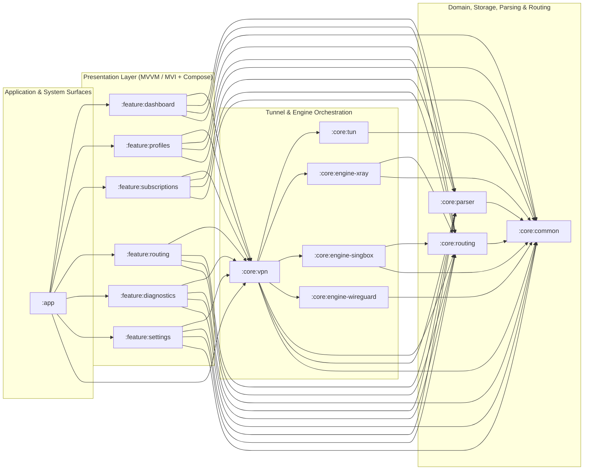
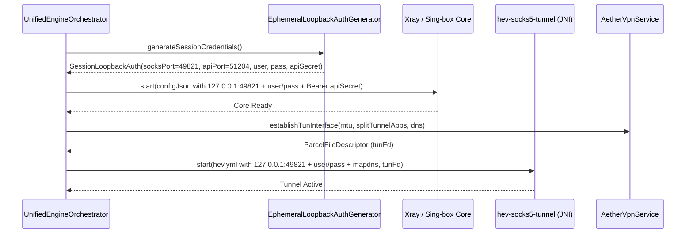
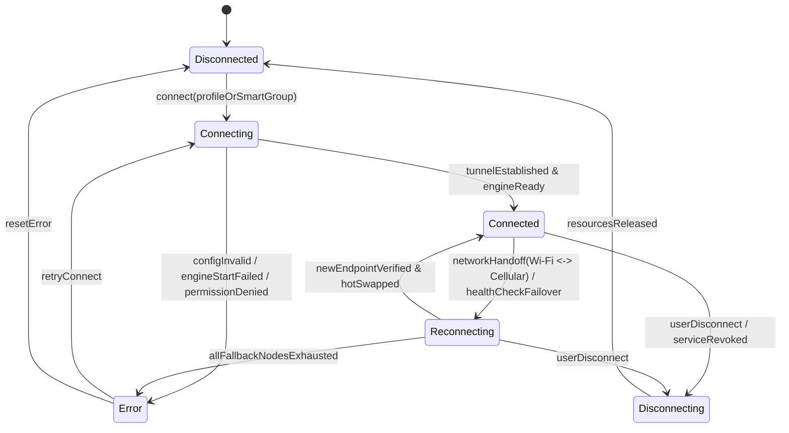

# AetherFlow Technical Architecture

## 1. System Overview

**AetherFlow** is a commercial-grade, multi-core Android VPN and universal network tunnel client engineered for high-throughput packet forwarding, active Deep Packet Inspection (DPI) resistance, and deterministic connection reliability on Android 7.0 through Android 16 (`minSdk = 24`, `targetSdk = 36`).

AetherFlow unifies three battle-tested proxy/VPN engines behind a single **Unified Engine Orchestrator** and a **Dual Native TUN Subsystem**:
1. **Xray-core (`libv2ray` / `AndroidLibXrayLite`)**: Powers VLESS (`XTLS-RPRX-Vision`, `REALITY` with uTLS and post-quantum ML-DSA-65 `mldsa65Verify`), VMess AEAD, Trojan, Shadowsocks-2022, XHTTP (`splithttp` + `xmux`), and `finalmask` TCP ClientHello fragmentation / UDP noise injection.
2. **Sing-box (`experimental/libbox`)**: Powers QUIC and anti-TLS-in-TLS protocols including Hysteria 2 (Brutal CC + Salamander + UDP port hopping), TUIC v5, AnyTLS v2, ShadowTLS v3, NaiveProxy, Juicity, Mieru, and SSH tunnels, while exposing an authenticated loopback Clash-compatible WebSocket/REST API for real-time per-socket telemetry.
3. **AmneziaWG / WireGuard (`org.amnezia.awg`) & OpenVPN**: Powers native WireGuard tunnels enhanced with `Jc`, `Jmin`, `Jmax`, `S1`, `S2`, and `H1`–`H4` junk-packet/header obfuscation, automated 1-tap Cloudflare WARP & WARP-in-WARP detour chaining, and `.ovpn` profiles.

---

## 2. Module Dependency Graph

---

## 3. Native JNI / Gomobile Binary Integration Strategy

To guarantee both peak native packet-forwarding throughput on Android devices (`arm64-v8a`, `armeabi-v7a`, `x86_64`) and 100% deterministic JVM unit testing on headless CI runners without requiring kernel `/dev/tun`:

### 3.1 Clean Native Bridge Interfaces
Every JNI or `gomobile` boundary is encapsulated behind an injectable Kotlin interface:

| Module | Kotlin Bridge Interface | Native Runtime Target | Fallback / JVM Test Behavior |
| :--- | :--- | :--- | :--- |
| `:core:tun` | `HevTunNativeBridge` | `libhev-socks5-tunnel.so` (`hev.htproxy.TProxyService`) | Dynamic JNI / reflection loader; records YAML & `tunFd` lifecycle in JVM tests |
| `:core:tun` | `BadVpnNativeBridge` | `libtun2socks.so` (`badvpn-tun2socks` binary/JNI) | Supervised process controller with graceful mockable executor |
| `:core:engine-xray` | `XrayNativeBridge` | `libv2ray.aar` (`libv2ray.Libv2ray` & `CoreController`) | Reflection/JNI adapter over `CoreController.startLoop(json, fd)` & `measureOutboundDelay` |
| `:core:engine-singbox` | `SingBoxNativeBridge` | `libbox.aar` (`io.nekohasekai.libbox.BoxService`) | Reflection/JNI adapter over `BoxService` & `PlatformInterface` |
| `:core:engine-wireguard` | `WireGuardNativeBridge` | `amneziawg-android` (`org.amnezia.awg.backend.GoBackend`) | Reflection/JNI adapter over `GoBackend` userspace WireGuard/AWG tunnel |

### 3.2 Reproducible Native Artifact Verification
- `gradle/native-cores.gradle.kts` registers `downloadNativeCores` and `verifyNativeCores`, which fetch pinned release `.aar`/`.so` artifacts and verify SHA-256 digests before installing into module `libs/` or `src/main/jniLibs/<abi>/`.

---

## 4. Ephemeral Anti-Fingerprinting Loopback Architecture

Static localhost proxy listeners (such as `127.0.0.1:10808` or `127.0.0.1:9090`) allow unprivileged apps on the same device to detect active VPN/proxy software via local TCP port scanning. AetherFlow eliminates this vector:

1. On every `Connecting` transition, `EphemeralLoopbackAuthGenerator` binds `ServerSocket(0, 1, InetAddress.getByName("127.0.0.1"))` briefly to select guaranteed free high ephemeral ports and generates 32-byte `SecureRandom` hex credentials.
2. Both the selected proxy engine's `socks` inbound and `hev-socks5-tunnel`'s `socks5:` YAML block receive the exact same ephemeral port, `username`, and `password`.
3. `AetherVpnService` adds its own application package via `VpnService.Builder.addDisallowedApplication(packageName)` (unless per-app whitelist mode explicitly overrides, in which case `protect(fd)` is enforced), preventing routing loops cleanly on Android 16.

---

## 5. Deterministic Connection State Machine & Auto-Failover

`VpnStateMachine` enforces strict, serialized coroutine state transitions via a `Mutex`-guarded `MutableStateFlow<VpnConnectionState>`:

### Smart Node Selection & Zero-Drop Failover
- **Concurrent Probing**: `LatencyTester` runs bounded-concurrency (`Semaphore(16)`) probes supporting TCP SYN/Handshake RTT, Real HTTP-204 URL-Test (`https://cp.cloudflare.com/generate_204`), and downlink throughput sampling.
- **Health Watchdog**: While `Connected` in Smart Auto-Select mode, `UnifiedEngineOrchestrator` periodically measures active tunnel HTTP-204 delay. If consecutive timeouts or extreme latency spikes exceed configured thresholds, the state transitions `Connected -> Reconnecting`, ranks standby nodes in the active group, hot-swaps the proxy core while keeping the `VpnService` blocking interface alive (preventing packet leaks during handoff), and returns to `Connected`.

---

## 6. Android 16 (SDK 36) Compliance & Security Posture

- **Foreground Service Compliance**: `AetherVpnService` declares `android:foregroundServiceType="systemExempted"` paired with `FOREGROUND_SERVICE_SYSTEM_EXEMPTED` and `FOREGROUND_SERVICE` permissions, invoking `ServiceCompat.startForeground(..., FOREGROUND_SERVICE_TYPE_SYSTEM_EXEMPTED)` immediately within the 5-second ANR window.
- **Credential Encryption at Rest**: Sensitive fields (UUIDs, private keys, passwords, pre-shared keys, subscription tokens) are encrypted using an hardware-backed `AndroidKeyStore` `AES/GCM/NoPadding` 256-bit master key inside Jetpack Proto DataStore, while portable `.vpnbak` archives use `PBKDF2WithHmacSHA256` (210,000 iterations, 16-byte random salt) + `AES-256-GCM`.
- **Leak Prevention**: When FakeIP or Strict Leak Shield is enabled, IPv6 blackholing (when upstream lacks IPv6), WebRTC STUN UDP port filtering, and Split-DNS domestic/remote isolation ensure zero plaintext DNS queries escape on physical interfaces.
